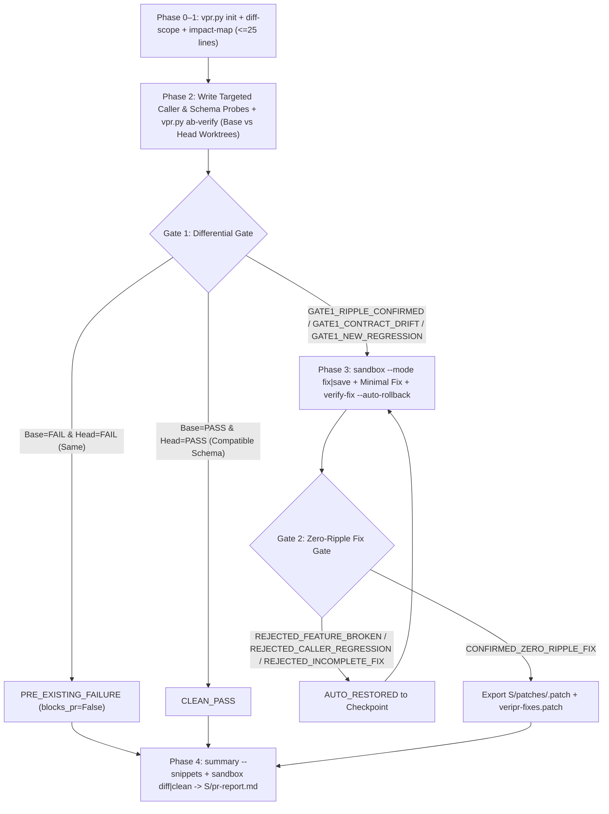

# VeriPR ⚡🔀

[](https://agentskills.io)
[](https://github.com/lufus4826-eng/veripr/actions/workflows/ci.yml)
[](https://github.com/lufus4826-eng/veripr/releases/tag/v1.1.0)
[](LICENSE)
[](#installation)
[](#supported-stacks--language-adapters)
[](#prerequisites)
[](https://github.com/lufus4826-eng/verihunt)

> **VeriPR — Pre-Commit & PR Differential Guard Skill with 1-Hop Caller Impact Mapping, Parallel Base vs. Head Git Worktree Verification, Recursive API Schema-Hash Drift Detection, and Zero-Ripple Fix Gates.**  
> Built as the fast (1–2 minute) daily pre-commit and pre-PR check developers reach for every day. VeriPR maps changed symbols (`diff-scope`), discovers untouched 1-hop callers (`impact-map`), runs parallel differential tests across `Base` and `Head` Git worktrees (`ab-verify`) so pre-existing broken tests never blame the current PR, and verifies fixes inside an isolated sandbox (`verify-fix`) to guarantee **zero caller regressions and 100% preservation of new PR features**.

---

## Why VeriPR?

When reviewing changes right before `git commit` or opening a Pull Request, four recurring failure modes slip past standard unit tests:
1. **1-Hop Caller Ripple Blindness:** Changing a helper function passes its own unit tests yet crashes a caller in another file (for example, returning `None` instead of `0.0` when no coupon is supplied, causing `TypeError: unsupported operand type(s) for -: 'float' and 'NoneType'` inside the receipt generator).
2. **Silent API Schema / Contract Drift:** Renaming or removing a JSON response key (e.g., `"total_cents"` -> `"amount_cents"`) or shifting a field type (`number -> null`) breaks frontend clients and downstream consumers while local HTTP 200 checks still pass.
3. **False Blame from Pre-Existing Main-Branch Debt:** Running the full suite reports an unrelated legacy test failure, wasting developer time or unfairly blocking a clean PR.
4. **Naive Fixes Wiping Out New PR Features:** Asking an AI or rushed developer to "fix the failing caller" often results in reverting the edited function back to `Base`, silently deleting the new feature introduced in the PR.

**VeriPR (`v1.1.0`) eliminates all four using a zero-dependency Python CLI engine (`scripts/vpr.py`) and strict 2-Layer Dual-Gate verification:**
- **Gate 1 — Differential Gate (`ab-verify` on Parallel Git Worktrees `Base` vs. `Head`):**
  - **Multi-Commit Branch & Untracked Helper Awareness:** Automatically detects `git merge-base <trunk> HEAD` on multi-commit feature branches (so bugs introduced in early branch commits never slip past) and preserves newly created untracked non-ignored helper modules inside `worktree-head` and `S/sandbox-fix/` (while filtering `.gitignore` build artifacts).
  - **Identical Twin Execution (`VERIPR_TARGET_ROOT`):** Runs every 1-hop caller test, regression check, and `VERIPR_PAYLOAD:` probe against isolated snapshots of **Base** (`S/tmp/worktree-base`) and **Head** (`S/tmp/worktree-head`).
  - **Multi-Sample Recursive API Structure Hashing (`schema_hash`):** Converts nested JSON/dict responses into canonical structure-and-type signatures and merges multiple samples per endpoint (`merge_schema_signatures`) — resolving `[]` + populated arrays and nullable optional fields so empty-list edge samples never hide nested object key renames (`GATE1_CONTRACT_DRIFT`) while tolerating harmless additive keys.
  - **Pre-Existing Debt Filtering (`PRE_EXISTING_FAILURE`):** Failures that reproduce identically on both `Base` and `Head` are marked `blocks_pr=false` and filtered out automatically in Gate 2 — while any brand-new failure introduced on top of legacy debt is caught as `GATE1_NEW_REGRESSION`.
- **Gate 2 — Zero-Ripple Fix Gate (`verify-fix --auto-rollback` on `S/sandbox-fix/`):**
  - **Full Contract & Caller Verification:** Re-runs the target check, confirms backward-compatible `schema_hash` parity with `Base`, and runs 1-hop callers (`--caller-cmd`) plus the project test suite (`--test-cmd`, automatically filtering verified `PRE_EXISTING_FAILURE` tests).
  - **Mandatory New Feature Preservation (`--feature-cmd`):** Explicitly runs the new PR feature tests. Any naive revert or over-broad edit that breaks the developer's new feature is immediately rejected with **`REJECTED_FEATURE_BROKEN`** and **auto-rolled back byte-for-byte** to the checkpoint.
  - **Pure LF Cross-Platform Incremental Patches:** On `CONFIRMED_ZERO_RIPPLE_FIX`, exports per-finding patches (`S/patches/<id>.patch`) and a cumulative patch (`S/patches/veripr-fixes.patch`) written strictly with pure LF (`\n`) bytes and validated with `git apply --check --ignore-space-change --ignore-whitespace` across Windows, macOS, and Linux.

---

## Verified E2E Case Study (`examples/checkout_pr_demo`)

Tested end-to-end across all phases via [`examples/checkout_pr_demo/run_demo.py`](examples/checkout_pr_demo/run_demo.py) — see the generated [`sample-pr-report.md`](examples/checkout_pr_demo/sample-pr-report.md):

| ID | Scenario (`checkout_app/`) | Gate 1 (`Base` vs. `Head` Worktree) | Gate 2 (`S/sandbox-fix/` + `--feature-cmd`) | Dual-Gate Verdict |
|---|---|---|---|---|
| **PR-1** *(Try #1)* | `calculate_discount` returns `None` on empty coupon; naive revert to `Base` wipes out `GOLD` tier `+5.0` bonus | `Base=PASS`, `Head=FAIL` (`TypeError` in `generate_receipt`) -> **`GATE1_RIPPLE_CONFIRMED`** | Target=`PASS`, Callers=`PASS`, **`FeaturePreserved=FAIL`** (`test_gold_loyalty_tier_adds_bonus`) | **REJECTED_FEATURE_BROKEN + AUTO_RESTORED** |
| **PR-1** *(Try #2)* | `calculate_discount` returns `0.0` on empty coupon while preserving `GOLD` bonus | **`GATE1_RIPPLE_CONFIRMED`** | Target=`PASS`, Callers=`PASS`, Suite=`PASS_FILTERED_PREEXISTING (ran=4, ignored=1)`, `FeaturePreserved=PASS` | **CONFIRMED_ZERO_RIPPLE_FIX** (`patches/pr1.patch`) |
| **PR-2** | `build_checkout_response` silently renames `"total_cents"` -> `"amount_cents"` | `Base schema=8a04babea65a1cc5`, `Head schema=7857c0ee78b13d37` -> **`GATE1_CONTRACT_DRIFT`** | `Schema=RESTORED (8a04babea65a1cc5)`, Callers=`PASS`, Suite=`PASS_FILTERED_PREEXISTING`, `FeaturePreserved=PASS` | **CONFIRMED_ZERO_RIPPLE_FIX** (`patches/pr2.patch`) |
| **PR-3** | Pre-existing rounding bug in `legacy_tax_export.py` (`test_legacy_tax_rounding`) | `Base=FAIL`, `Head=FAIL` (identical signature) -> **`PRE_EXISTING_FAILURE`** (`blocks_pr=False`) | Non-blocking; filtered automatically during Gate 2 suite runs | **FILTERED_NON_BLOCKING** |

> **Key takeaway:** `diff-scope` and `impact-map` pinpointed both modified functions and flagged the untested 1-hop caller `generate_receipt` (`arithmetic_op`) in 4 lines. Gate 1 separated `PR-1` & `PR-2` from legacy test debt `PR-3`, Gate 2 blocked a naive revert (`PR-1 Try #1`) that erased the developer's `GOLD` loyalty feature, and `veripr-fixes.patch` passed `git apply --check` with `cleanliness: CLEAN (0 new/modified files outside .bughunt/)`.

---

## Try the 1-Command Live Demo

Clone the repo and execute the complete `checkout_pr_demo` differential showcase (including `diff-scope`, `impact-map`, `Base` vs. `Head` worktree checks, `REJECTED_FEATURE_BROKEN` auto-rollback, `PRE_EXISTING_FAILURE` filtering, incremental `.patch` export, and worktree cleanup) in one command:

```bash
git clone https://github.com/lufus4826-eng/veripr.git
cd veripr
python -B examples/checkout_pr_demo/run_demo.py
```

---

## Quick Start

### Prerequisites
- **Python 3.9+** available on `PATH` as `python` (used by `scripts/vpr.py`; **zero external `pip` packages required**).
- **Git** CLI available on `PATH` for diff extraction, worktree isolation, and `.patch` verification.
- Your target project's native runtime/toolchain (Python, Node.js/TS, Go, Java/Kotlin, .NET, or Rust).

### Installation

#### 0. Full VeriHunt Suite via VeriPilot (Recommended — One-Command Install)
Install `VeriPilot` + `VeriPR` + `VeriHunt` + `VeriSec` + `VeriPerf` together across 6 agent platforms:
```bash
git clone https://github.com/lufus4826-eng/veripilot.git ~/.gemini/config/skills/veripilot
python ~/.gemini/config/skills/veripilot/scripts/vpilot.py install --platform antigravity   # or --platform claude | --platform all
```

#### 1. Claude Code
```bash
# User-global installation (Recommended)
git clone https://github.com/lufus4826-eng/veripr.git ~/.claude/skills/veripr

# Or project-local installation
git clone https://github.com/lufus4826-eng/veripr.git .claude/skills/veripr
```

#### 2. Google Antigravity / Gemini CLI
```bash
# Linux / macOS
git clone https://github.com/lufus4826-eng/veripr.git ~/.gemini/config/skills/veripr

# Windows (PowerShell)
git clone https://github.com/lufus4826-eng/veripr.git "$HOME\.gemini\config\skills\veripr"
```

#### 3. Cursor / Windsurf / Roo Code / Cline / Other Agent Runtimes
```bash
git clone https://github.com/lufus4826-eng/veripr.git .agents/skills/veripr
```

### Example Prompts
```text
/veripr run a pre-commit check on my current changes for 1-hop caller ripple effects and API contract drift
/veripr compare Base vs Head before I open this PR and filter out pre-existing broken tests
/veripr verify fixes in sandbox without breaking my new feature and export incremental .patch files
```

---

## Methodology & 4-Phase Workflow



| Phase | Purpose | Enforcement Mechanism |
|---|---|---|
| **Phase 0–1: Init, Diff-Scope & 1-Hop Impact Map** | Auto-detect `Base` vs. `Head`, inspect semantic deltas & find untested 1-hop callers | `vpr.py init` + `diff-scope` + `impact-map` (`<=25` lines each, comment/docstring-immune) |
| **Phase 2: Differential Gate (`Gate 1`)** | Run identical tests & schema probes on parallel `Base` and `Head` Git worktrees | `vpr.py ab-verify` (`GATE1_RIPPLE_CONFIRMED` / `GATE1_CONTRACT_DRIFT` vs. `PRE_EXISTING_FAILURE`) |
| **Phase 3: Zero-Ripple Fix Gate (`Gate 2`)** | Fix confirmed ripple/contract issues inside `S/sandbox-fix/` without losing new PR features | `vpr.py sandbox --mode fix\|save` + `verify-fix --auto-rollback --feature-cmd` + `.patch` export |
| **Phase 4: Report, Patch Export & Cleanliness** | Deliver concise impact report, ready-to-apply `.patch` diffs, and pruned worktrees | `vpr.py summary --snippets` + `sandbox --mode diff\|clean` (`git worktree remove` + `prune`) |

---

## `scripts/vpr.py` CLI Reference

| Subcommand | Description |
|---|---|
| `init [--root .] [--base REF] [--head REF\|WORKTREE]` | Creates `.bughunt/pr-<YYYYMMDD-HHMMSS>/{tests,logs,tmp,patches}` + `.cache`, auto-detects `git merge-base` on feature branches (or `HEAD` vs. `WORKTREE` / `HEAD~1` vs. `HEAD`), snapshots `fs-before.txt`, initializes `worklog.md`, and prints 1-line JSON. |
| `diff-scope [--root .] [--s S]` | Parses Git hunks (including untracked non-ignored modules) + Python AST / multi-language brace symbols to detect `RETURN_SHAPE_CHANGED`, `CONTRACT_KEY_RENAMED_OR_DROPPED`, `SIGNATURE_CHANGED`, and `ERROR_GUARD_REMOVED` (`<=25` lines). |
| `impact-map [--root .] [--s S] [--max-lines 25]` | Scans repository files (stripping comments and docstrings) for 1-hop callers, tracks return-value usage (`arithmetic_op`, `subscript_access`, `attr(...)`), checks `Tested=YES\|NO`, and caps output at `<=25` lines. |
| `ab-verify --s S --id ID --category CAT -- <cmd>` | Materializes parallel `worktree-base` & `worktree-head` (preserving untracked helper modules), executes `<cmd>` with `VERIPR_TARGET_ROOT`, merges multi-sample API schemas into `schema_hash`, and separates PR regressions/drift from `PRE_EXISTING_FAILURE` (`<=10`-line digest). |
| `verify-fix --s S --id ID [--auto-rollback] [--test-cmd "..."] [--caller-cmd "..."] [--feature-cmd "..."]` | Runs inside `S/sandbox-fix/`: enforces target fix + restored `schema_hash` + 1-hop callers + project suite (`PASS_FILTERED_PREEXISTING` for verified legacy failures) + new PR feature preservation (`REJECTED_FEATURE_BROKEN`), exports pure LF `.patch` files verified via `git apply --check --ignore-space-change --ignore-whitespace`, and auto-restores on rejection. |
| `sandbox --s S --mode init-worktrees\|fix\|save\|rollback\|diff\|clean [--id ID]` | Manages parallel worktrees, `S/sandbox-fix/`, checkpoints, compact unified diffs (`<=8,000` chars), and full `git worktree remove/prune` + cleanliness checks. |
| `log --s S [--status "..."] [--entry "..."]` | Atomically updates `Status:` in `S/worklog.md` and appends timestamped 1-line entries. |
| `summary --s S [--snippets]` | Emits Markdown Gate 1 / Gate 2 tables, rejected rollback history, exported `.patch` paths, and compact `<=6`-line evidence snippets. |

### Supported Check & Probe Protocols
1. **Standard Test Runner Mode (`unittest` / `pytest` / `node:test` / `jest` / `vitest` / `go test`):** Resolve imported target modules via `VERIPR_TARGET_ROOT` (`worktree-base` -> `worktree-head` -> `sandbox-fix`) so identical assertions run across all three phases.
2. **Structured Schema-Hash Mode (`VERIPR_PAYLOAD:`):** Print a single-line JSON payload to stdout:
```text
VERIPR_PAYLOAD:{"id":"pr2","endpoint":"build_checkout_response","payload":{"order_id":"ORD-200","subtotal_cents":5000,"discount_cents":1000,"total_cents":4000,"currency":"USD"}}
```
`vpr.py` hashes recursive structure/types (`compute_schema_signature`), ignores dynamic values of matching types, permits safe additive fields, and raises `GATE1_CONTRACT_DRIFT` on missing keys, renamed keys, or incompatible type shifts.

---

## Supported Stacks & Language Adapters

| Language | Differential & Caller Target Strategy | Recommended Runner / Probe Pattern |
|---|---|---|
| **Python** | `VERIPR_TARGET_ROOT` prepended to `PYTHONPATH` + `sys.path[0]` (`PYTHONDONTWRITEBYTECODE=1`) | `unittest` / `pytest -p no:cacheprovider` + `VERIPR_PAYLOAD:` JSON |
| **Node.js / TS** | `pathToFileURL(process.env.VERIPR_TARGET_ROOT)` (ESM/TS) or `require(...)` (CJS) | `node --test` / `jest` / `vitest` + `VERIPR_PAYLOAD:` JSON |
| **Go** | Direct execution inside `worktree-base`, `worktree-head`, and `S/sandbox-fix/` (`GOPROXY=off`) | `go test -v -run ...` + `VERIPR_PAYLOAD:` stdout line |
| **Java / Kotlin (JVM)** | Isolated offline execution inside each worktree / sandbox | `mvn -o test -Dtest=...` / `gradle --offline test` |
| **C# (.NET)** | Isolated `--no-restore` execution inside each worktree / sandbox | `dotnet test --no-restore --filter ...` |
| **Rust** | Isolated offline Cargo execution (`CARGO_NET_OFFLINE=true`) inside each worktree / sandbox | `cargo test --offline --test ...` |

---

## Repository Structure & Session Deliverables

### Repository Layout
```text
veripr/
├── SKILL.md                          # Master 4-phase workflow & token efficiency guardrails
├── README.md                         # Documentation & 2-layer differential methodology
├── CONTRIBUTING.md                   # Contributor & language adapter authoring guide
├── LICENSE                           # MIT License
├── scripts/
│   └── vpr.py                        # Zero-dependency stdlib Python CLI engine (v1.1)
├── tests/
│   └── test_vpr_cli.py               # 12-suite cross-platform unit & integration tests
├── examples/
│   └── checkout_pr_demo/             # 1-command runnable E2E showcase + sample-pr-report.md
└── resources/
    ├── ripple-taxonomy.md            # 4 ripple & API contract failure patterns
    ├── report-template.md            # English 7-section report template (Phase 4 lazy-load)
    ├── report-template-th.md         # Thai 7-section report template (Phase 4 lazy-load)
    └── lang/                         # Language-specific differential & probe adapters
        ├── 00-common.md              # VERIPR_TARGET_ROOT, VERIPR_PAYLOAD & Gate 1/2 rules
        ├── python.md
        ├── js-ts.md
        ├── go.md
        ├── jvm.md
        ├── dotnet.md
        └── rust.md
```

### Session Output (`.bughunt/pr-<YYYYMMDD-HHMMSS>/`)
```text
.bughunt/pr-20261118-094956/
├── pr-report.md          # Final 7-section differential impact report & applied patch log
├── worklog.md            # Append-only progress journal
├── tests/                # Targeted 1-hop caller & API contract verification scripts
├── patches/              # Exported incremental patches (pr1.patch, pr2.patch, veripr-fixes.patch)
└── logs/                 # Base/Head/Fix logs, diff_scope.json, impact_map.json & fs snapshots
```
> **Note:** Add `.bughunt/` to `.gitignore` or `.git/info/exclude` — temporary session artifacts and patches belong outside committed source trees.

---

## VeriHunt Ecosystem

VeriPR is part of the **VeriHunt Ecosystem**, sharing the `.bughunt/` isolation convention and empirical Dual-Gate philosophy:
- **[VeriPilot (VeriHunt Suite)](https://github.com/lufus4826-eng/veripilot):** Smart Router, Cumulative Overlay Orchestrator & One-Command Suite Installer (AI Coding Agent Skills Orchestrator).
- **[VeriHunt](https://github.com/lufus4826-eng/verihunt):** General correctness, edge-case, and concurrency defect hunting (`FAIL` -> `PASS` in `sandbox-fix`).
- **[VeriPerf](https://github.com/lufus4826-eng/veriperf):** Statistical profiling (`p50`/`p95`, Peak Memory, `ABBA` interleaving, `>= 15%` speedup Dual Gate).
- **[VeriSec](https://github.com/lufus4826-eng/verisec):** Business-logic & authorization security auditing (`surface-map`, 100% network-isolated PoCs, secret redaction, Dual-Gate remediation verification).
- **[VeriPR](https://github.com/lufus4826-eng/veripr):** Daily 1–2 minute pre-commit & PR differential verification (1-hop caller `impact-map`, `Base` vs. `Head` worktree checks, recursive `schema_hash`, pre-existing failure filtering, and Zero-Ripple Fix Gate).

---

## Contributing & License

- Contributions, new language adapters, and AST/impact-map enhancements are welcome! See [CONTRIBUTING.md](CONTRIBUTING.md).
- Licensed under the **MIT License** — see [LICENSE](LICENSE).
